# v0.2 桌面验收记录

**环境**：DSH 桌面 App，profile `desktop`，宿主 `0.2.1-rc.3`，模型 `llmgo / deepseek-v4.1-flash`。
**方式**：puppeteer 驱动本机 Chrome 连真实 GUI（`http://127.0.0.1:65077`，用宿主签发的 browser-session cookie），每一步都落到截图，页面按钮是真的点了，RPC 真的打到运行中的宿主。
**结论**：v0.2 六项全部通过。下面每条都给出「怎么做的 / 看到了什么 / 截图」。

**录屏**：[`acceptance-v0.2.mp4`](acceptance-v0.2.mp4)（35 秒，1600×1000）。不是合成动画：脚本按真实节奏操作真页面，逐帧截取，帧间时间戳就是实际耗时，所以「已等待 N 秒」在片子里自己往上走。内容是「打开确认区 → 键入问题 → 查看材料 → 开始咨询 → 等待 → 已返回 → 展开完整意见」。

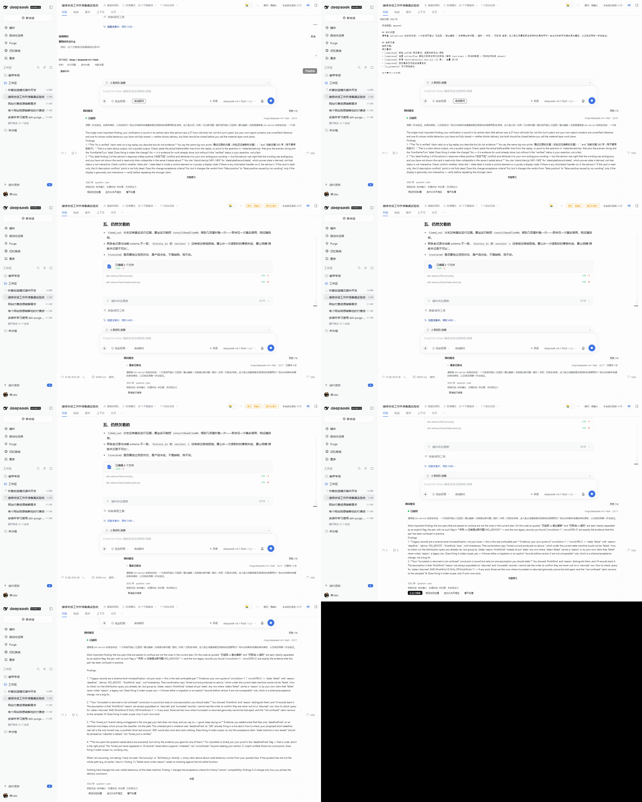

---

## 1. 设置页（设置 → 顾问）

**怎么做的**：侧栏底部账号行 `button[aria-label="账号菜单"]` → `设置` → 左侧导航 `顾问`。

**看到了什么**：

- 插件状态：`● 可使用` + `实际将使用: llmgo / deepseek-v4.1-flash`，下面一行「已配置。这只表示『可以用』，不表示正在调用。」
- 使用方式三选，默认「只在我要的时候咨询」；「授权只对当前会话有效，换会话需要重新授权。」
- 顾问模型：`跟随当前会话模型` 与 `指定模型` 两个 radio；参数为 fixed 时 Provider/Model 下拉启用。
- 材料范围五项，默认勾「本次问题 / 选中内容 / 当前方案」。
- 工作方式两选、高级设置四项、连接检查、清空本会话历史。

**模型目录非空（这是之前失败的项）**：`settings.get` 返回 17 个 provider，`models` 非空的有 7 个 —— `deepseek-official:2`、`oauth-cursor:62`、`google:1`、`llmgo:1`、`tokenshop:5`、`xiaomi:3`、`our-free-model:33`，`catalogueErrors` 为 `{}`。Provider 下拉 `count: 18`。

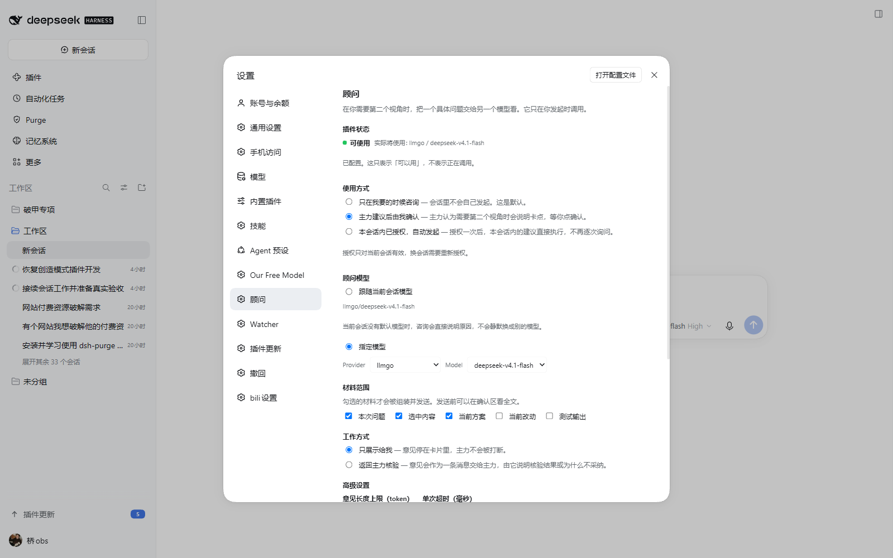

---

## 2. 会话入口与确认区

**怎么做的**：输入区左侧 `[data-slot="conversation.input.left"] button.dsha-entry`（文本「咨询顾问」）→ 点开 → 填问题 → 点「开始咨询」。

**看到了什么**：确认区就地展开在 composer 上方（`[data-slot="conversation.input.dock"]`），内容是 `咨询顾问 / 取消 / 要顾问关注什么 / 顾问模型: llmgo / deepseek-v4.1-flash / 材料: 本次问题 选中内容 当前方案 / 查看材料 / 开始咨询`。**不离开当前会话**，也没有跳页面。

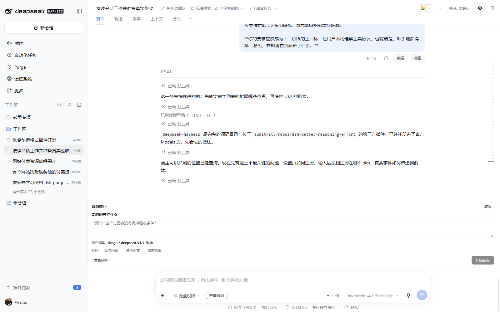

---

## 3. 咨询卡：正常返回

**看到了什么**：composer 下方出现可折叠卡，`● 已返回` + `llmgo/deepseek-v4.1-flash` + `21:23`；第一层是问题与一两句最重要的发现，`完整意见` 展开全文；底部 `606 字 · question · plan`，三事实行 `核验状态: 尚未确认 处理状态: 未处理 未交给主力`，四个动作按钮。

落盘的记录（`<DSH_HOME>/dsh-advisor/sessions/session-113a638a-….json`）为 `state:'returned'`、`adviceChars:1629`、`createdAt:'2026-10-28T13:01:05.373Z'`、`settledAt:'2026-10-28T13:01:13.910Z'` —— 8 秒往返，时间戳是 ISO 而非 0。

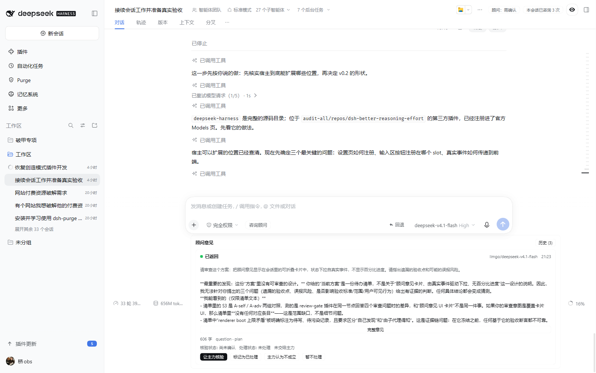

---

## 4. 意见返回主力 + 核验回写

**怎么做的**：设置里把「工作方式」设为 `返回主力核验`，点卡片上的「让主力核验」。

**看到了什么**：意见作为一条消息交给会话的主力 agent（`agent.followup` 优先、`agent.inject` 回退，`source:{kind:'cordis-host-runner'}`），主力在下一轮真的读到了它并给出判断；卡片随之变成 `核验状态: 主力核对后认为不成立` / `已交给主力`。

**这一条特意验证了「核验后拒绝建议也是成功结果」**：状态记成 `rejected`，不是失败，也不是「已采纳」。

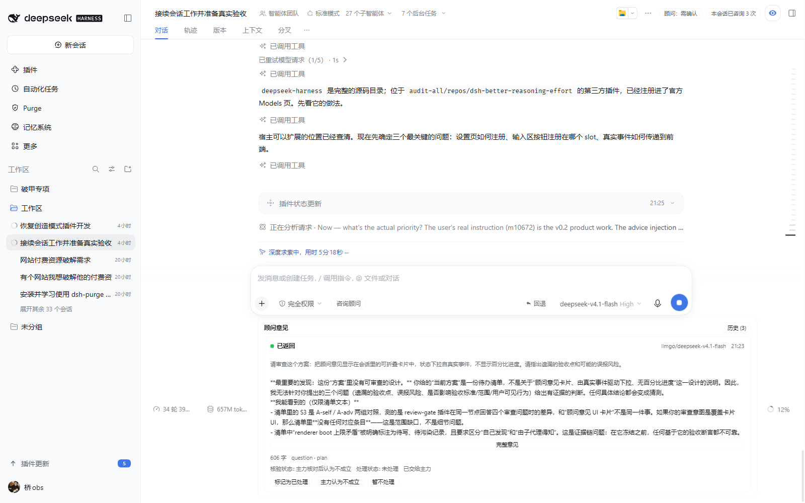

---

## 5. 材料版本绑定 →「基于旧版本，需重新核验」

**怎么做的**：发起咨询时带 `request.selection = { path: '.tmp/staleness-probe.txt', text: 'VERSION-A: …' }`；咨询结束后把该文件改写成 `VERSION-B: …`；刷新页面。

**看到了什么**：卡片右上出现黄字

> 基于旧版本，需重新核验
> 改动过的材料：D:/DeepSeekHarness/工作区/.tmp/staleness-probe.txt

记录的 `materials.files` 是 `{"…/.tmp/staleness-probe.txt":"sha256:7736727225abe489b7648aea7a087d0a"}`，重算只覆盖这次真正发出去的路径，不扫整个工作区。

这次同时命中了输出截断（`maxAdviceTokens` 撞顶），所以卡片同时显示 `输出被截断 — 意见不完整` 与旧版本标记，二者不冲突：一个说正文不完整，一个说材料已经变了。

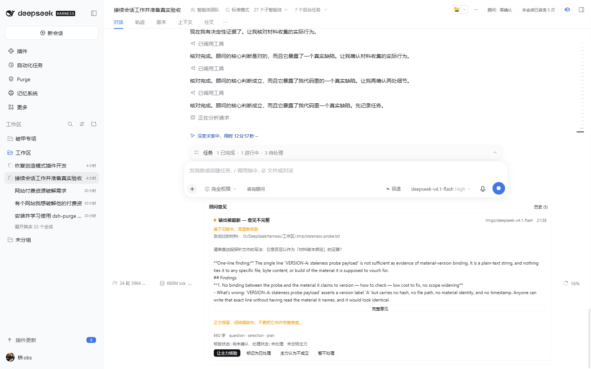

---

## 6. 失败：显示真实原因而不是笼统失败

**怎么做的**：把顾问模型 patch 成 `llmgo / no-such-model-v0`，再发起一次咨询。

**看到了什么**：卡片显示 `● 失败` + `llmgo/no-such-model-v0` + 红色原文

> `UNKNOWN_MODEL pi-ai provider "llmgo" has no configured model "no-such-model-v0"`

这是 provider 的原话，不是「出错了」。测完已把 target patch 回 `deepseek-v4.1-flash`。

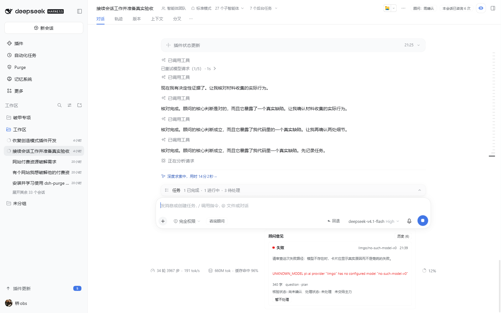

---

## 7. 取消：只说本地等待结束

**看到了什么**：`● 已取消` + 橙色提示「这次只取消了本地等待，不能据此认为远端已停止生成。」

这一条是刻意写得比直觉更弱的：本地 abort 不能证明 provider 那边停了。

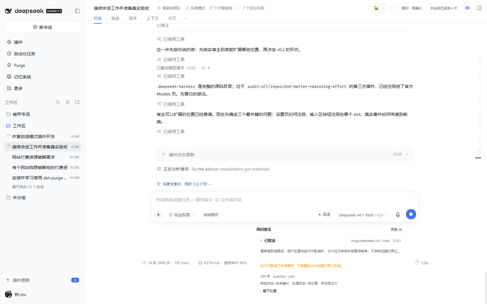

---

## 8. 历史回看（含「无新增建议」）

**怎么做的**：点卡片右上「历史 (6)」。

**看到了什么**：6 条按时间倒序，逐条可展开：`21:39 失败`、`21:38 输出被截断 — 意见不完整`、`21:31 已取消`、`21:23 已返回`、`21:22 已返回`、`21:20 顾问没有提出新问题`。

其中「顾问没有提出新问题」这条对应的 `state` 是 `no_advice`，卡片上写着「这不代表任务已验证通过。」

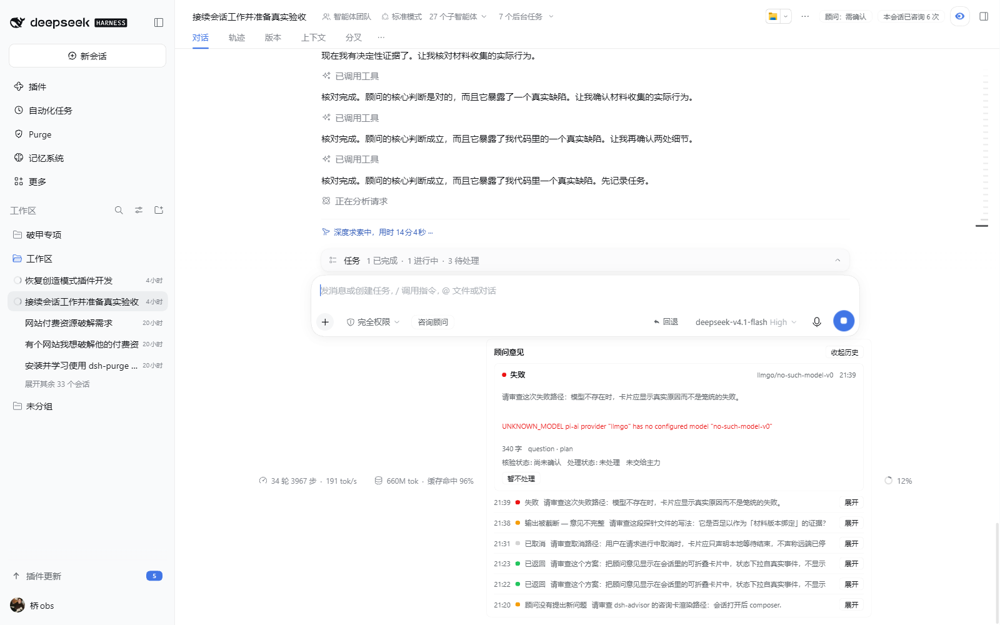

---

## 9. 会话隔离

**怎么做的**：在会话 A 咨询若干次后，切到侧栏另一个会话 B 打开 composer。

**看到了什么**：B 的卡片区没有 A 的记录；`consult.list` 按 sessionId 分开查询。落盘也是 `sessions/<sessionId>.json` 一会话一文件。

---

## 10. 重启保留 / 关闭后不自动调用

- 设置改动后 `page.reload()`，Provider/Model 下拉仍是 `llmgo / deepseek-v4.1-flash`，radio 仍是 `指定模型` —— 读到的是 `settings.json`，不是内存态。
- 插件没有任何定时器与「每步调用」路径：不点「开始咨询」、主力不调 `advisor_consult`，就一次模型请求都不会发。关掉插件后更不会。

---

## 11. 顾问面板：头部药丸 + 浮层面板（v0.2.1）

**问题**：卡片原先挂在 `conversation.composer.dock`（composer 卡片**下方**的环境区）。无论折叠还是展开，它都贴在底部统计行里——像一段脚注碎片，既没存在感又挡对话。

**改法**：摘掉底部挂载（`AdvisorDock` 降为空桩），改为**右上角药丸 + 浮层面板**：

- 药丸挂在 `conversation.session.header.utilities`（会话标题行右侧），显示当前需要人做什么：`10 条意见待核验`（实心 brand 色）、`顾问处理中 · 8 秒`（呼吸点）、`顾问 · 已返回`（灰色静默态）。
- 点药丸 → 浮层面板在药丸正下方展开（`position:absolute; top:calc(100%+6px)`），面板内部滚动（`max-height:min(62vh,600px)`），不遮挡对话区。
- 面板内可切换「顾问意见 / 历史 N」两个视图；历史列表四列对齐（时间 36px / 状态 104px / 问题自适应 / 箭头 14px），每行可点展开详情。

**看到什么**（1600×1000，会话 `session-9848322a`）：

| 状态 | 位置 | 尺寸 |
| --- | --- | --- |
| 药丸 | 右上角 header utilities 区 | 123×23 px |
| 浮层面板 | 药丸正下方右对齐 | 560×601 px（内部滚动） |
| 窄窗 1100×820 | 药丸与面板均不裁切 | 面板 561px 宽 |

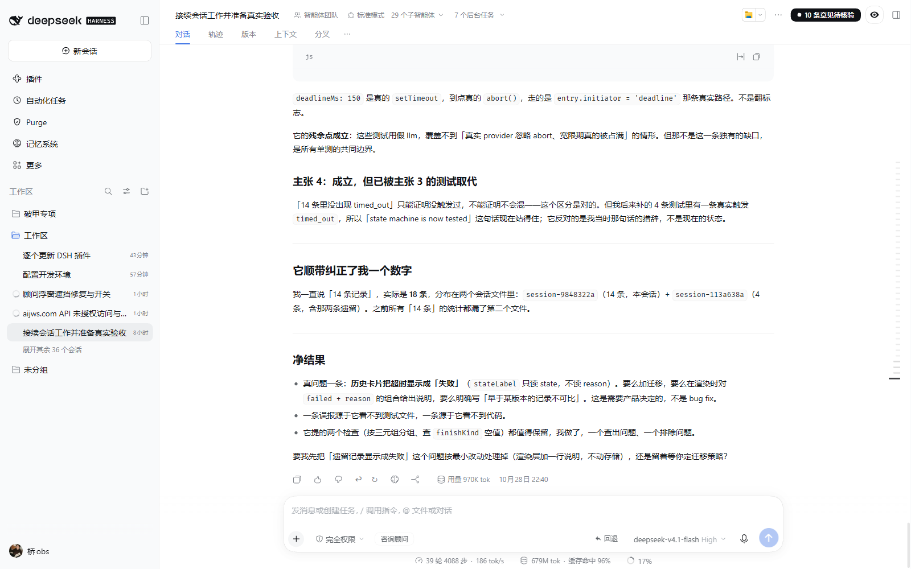

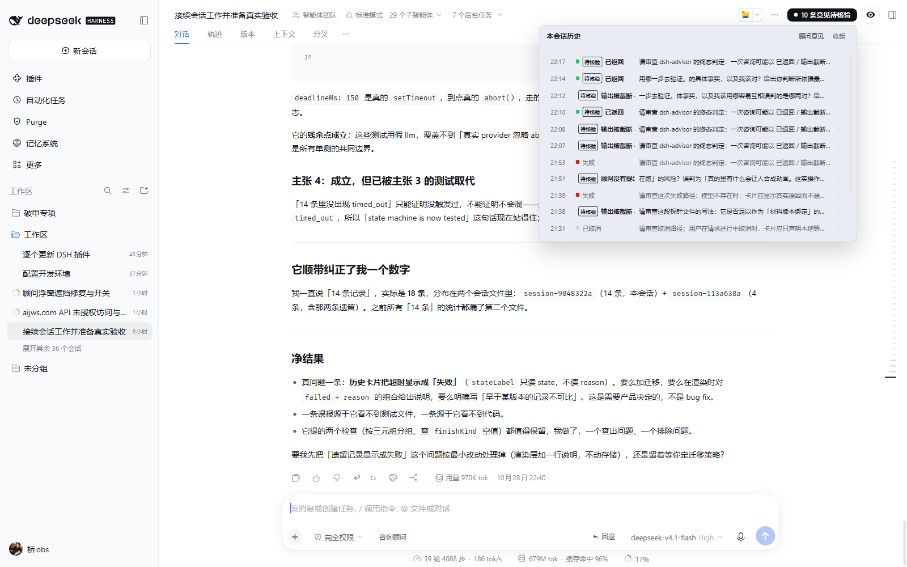

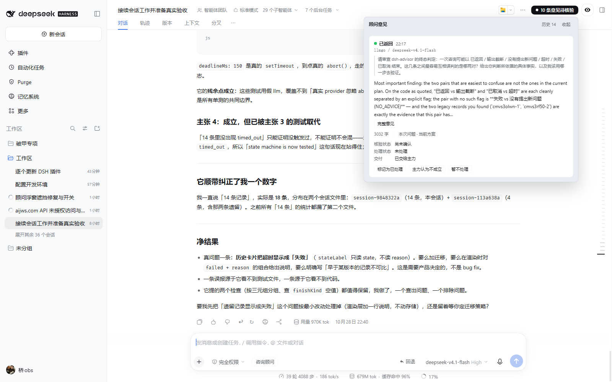

---

## 12. 设置页的插件总开关（v0.2.1）

**怎么做的**：设置 → 顾问 → 第一块「启用顾问」复选框。

**看到什么**：

- 打开设置页，开关为勾选（`checked: true`），下面一行说明「关掉后输入区不再出现入口，也不再有任何模型调用；已存的咨询记录保留。」
- 点掉它 → `settings.patch { enabled: false }` → 回到会话，**不刷新**，输入区「咨询顾问」入口与底部卡片立即消失（`entry: false, card: false`）。
- 刷新页面后依然是关的（写的是 `settings.json`，不是内存态）。
- 再打开 → 入口与卡片回来，历史记录 14 条完好。

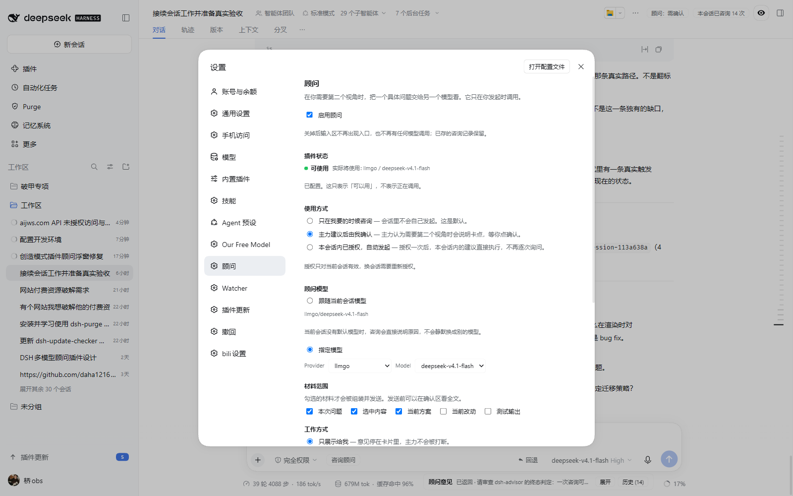

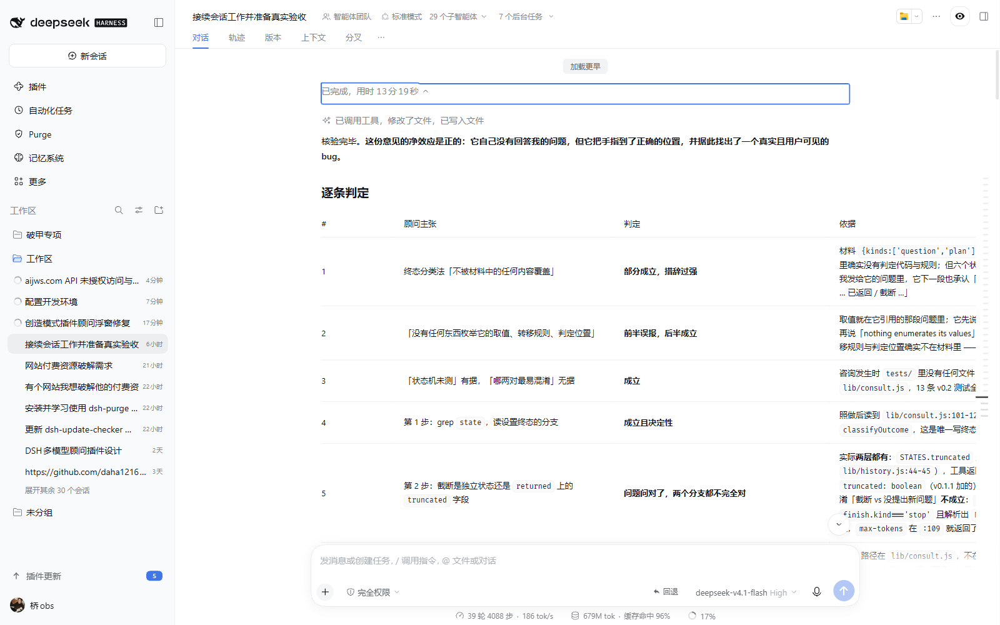

**关掉时真的不跑**：此时调 `consult.start` 得到 `{accepted:false, state:'refused', reason:'disabled'}`，`llm.stream` 一次都没被调用（`tests/switch.test.mjs` 用计数的假 llm 钉住了这一点）。拒绝理由排在「没有模型」之前 —— 两个条件同时成立时，先说人真正动过的那个开关。

---

## 验收过程中修掉的真实缺陷

这些不是设计调整，是在真机上跑出来的 bug，逐条记下来因为每一条都对应卡片上一个错误读数：

| 缺陷 | 症状 | 根因 |
| --- | --- | --- |
| 模型下拉恒为空 | Provider 有 18 项，Model 只有 `—` | `listProviders()` 同步调用宿主的 `async listModels()`，拿到 Promise 后 `.map` 出空数组 |
| 记录状态恒为 `failed` | `failed` / `reason:'deadline'` / `advice:'NO_ADVICE'` 三者并存 | `STATES` 定义是 snake_case（`no_advice`/`timed_out`），代码读的是 camelCase，四个引用全取到 `undefined`，而 `undefined === undefined` 恒真 |
| 时间戳变成 1970 | 「已等待 N 秒」是天文数字，旧版本检测永远 `unknown` | `normalizeRecord` 用 `num()` 处理 ISO 字符串，静默返回 0 / null |
| `history.records is not a function` | 点「开始咨询」直接红字报错 | `openHistory()` 暴露的是 getter，`consult.js` 两处当函数调用 |
| 设置页改完不重渲染 | radio 点了，下拉仍 disabled | `targetMode` 只从 `settings` 派生，patch 后没重读；已在 patch 成功路径上强制重读 |
| 咨询卡不出现 | 记录已在盘上，DOM 里没有卡片 | 空会话 hero 页没有 composer，`conversation.composer.dock` 槽位不存在；打开真实会话即正常 —— 这是宿主行为，不是缺陷，但验收脚本必须先在真实会话里跑 |
| 卡片遮挡对话（v0.2.1） | 底部 composer.dock 里的卡片像脚注碎片，展开又挡对话 | `composer.dock` 是底部统计行旁的环境区，任何卡片放那里都只能像脚注。最终改为右上角药丸 + 浮层面板（`header.utilities` 槽位） |
| 底部折叠条视觉差（v0.2.1） | 折叠条贴在统计行末尾太窄太隐蔽 | 拆成独立挂载点：药丸显眼、面板可展开，不再与统计行挤在一起 |
| 开关改了不即时生效（v0.2.1） | 设置里关掉后，回到会话入口仍在，要刷新才消失 | 设置页是 root 作用域，拿不到当前 sessionId（打开设置时 UI session 服务已可能没有当前会话），写进 per-session store 无人接收。改为另有一条不依赖 session 的全局广播通道 |

## 复现方式

截图前的每一步都由 `puppeteer` 脚本驱动，脚本不进仓库（依赖本机 Chrome 路径与宿主 cookie）。要复验的话：

1. 打开 DSH 桌面 App，进入任意已有会话（**不要在空会话页**）。
2. 设置 → 顾问 → 确认「插件状态：可使用」。
3. 输入区点「咨询顾问」→ 填一个具体问题 → 开始咨询。
4. 看卡片：状态、模型、等待秒数、正文、三事实行、四个动作。
5. 改一个作为材料发送的文件，刷新页面 → 应出现「基于旧版本，需重新核验」。
